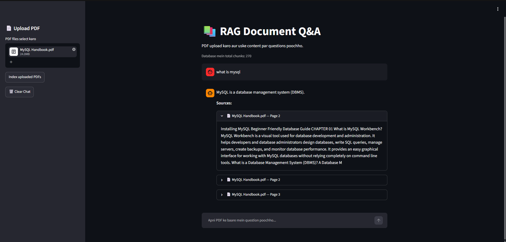

🚀 **Live Demo:** [Open RAG Document Q&A App](https://rag-document-app-rrawtru3plvj7nojl5kqip.streamlit.app/)
 # RAG-Based Document Question Answering System

A Python-based application that allows users to upload PDF documents and ask questions about their content using Retrieval-Augmented Generation (RAG).

The application retrieves relevant passages from indexed documents and uses a locally running Large Language Model (LLM) to generate context-aware answers with source information.

## Features

- Upload PDF documents through a Streamlit web interface.
- Extract text from PDFs using PyPDF.
- Split extracted text into overlapping chunks.
- Generate embeddings using Sentence Transformers.
- Store and search document chunks with ChromaDB.
- Generate answers using a local Ollama language model.
- Display source document and page information.
- Avoid indexing identical PDFs more than once.
- Evaluate retrieval quality and basic answer quality.
- Abstain from answering when retrieved document content is insufficiently relevant.

## Technologies Used

| Component | Technology |
|---|---|
| Programming language | Python |
| User interface | Streamlit |
| PDF text extraction | PyPDF |
| Embedding model | `all-MiniLM-L6-v2` |
| Vector database | ChromaDB |
| Local LLM runtime | Ollama |
| Language model | `qwen2.5:1.5b` |

## How It Works

1. The user uploads a PDF document.
2. The application extracts readable text from the PDF.
3. The text is divided into smaller, overlapping chunks.
4. Sentence Transformers converts the chunks into vector embeddings.
5. ChromaDB stores the chunks, embeddings, and document metadata.
6. A user submits a question through the Streamlit interface.
7. The question is converted into an embedding.
8. ChromaDB retrieves semantically relevant document chunks.
9. A relevance threshold filters out chunks that are too dissimilar.
10. Ollama generates an answer using the retrieved context.
11. The application displays the answer and available source-page information.

If no chunks pass the relevance threshold, the evaluation workflow abstains instead of calling the LLM.

## Prerequisites

Install the following before running the application:

- Python compatible with the project's dependencies.
- Git.
- Ollama.
- Sufficient memory and disk space for the embedding model and local LLM.

## Installation and Setup

### 1. Clone the repository

```bash
git clone https://github.com/sarthaksaini01/rag-document-qa.git
cd rag-document-qa
```

### 2. Create and activate a virtual environment

Windows PowerShell:

```powershell
python -m venv venv
.\venv\Scripts\Activate.ps1
```

### 3. Install dependencies

```powershell
python -m pip install -r requirements.txt
```

### 4. Download the Ollama model

Install Ollama from its official website:

https://ollama.com/

Then run:

```powershell
ollama pull qwen2.5:1.5b
```

Ensure Ollama is running before using the application.

### 5. Start the application

From the directory containing `app.py`, run:

```powershell
python -m streamlit run app.py
```

Open the local URL printed in the terminal. It is usually:

`http://localhost:8501`

## Usage

1. Start the Streamlit application.
2. Upload a PDF using the interface.
3. Index the uploaded document using the application's indexing control.
4. Enter a question about the document.
5. Review the generated answer.
6. Check the source document and page information to verify the answer.

## Evaluation

The project includes scripts for testing retrieval and generated answers.

Run the answer evaluation script from the directory containing `evaluate_answers.py`:

```powershell
python .\evaluate_answers.py
```

The current evaluation uses four test questions: three about MySQL concepts and one unrelated question about quantum mechanics.

### Latest Recorded Results

| Metric | Result |
|---|---:|
| Test questions | 4 |
| Expected-page checks | 3/3 |
| Keyword checks | 3/3 |
| Out-of-scope abstention checks | 1/1 |

These results apply only to the current test set. Keyword matching is a basic evaluation method and does not guarantee factual correctness or detect every hallucination.

The cosine-distance threshold is a configurable heuristic and may need adjustment for other documents and questions.
## Application Screenshot




## Project Structure

The repository contains the application, supporting source code, and testing scripts. The exact directory layout may vary depending on the local project version.

```text
rag-document-qa/
|-- app.py
|-- requirements.txt
|-- README.md
|-- test_setup.py
|-- test_retrieval.py
|-- evaluate_rag.py
|-- evaluate_answers.py
|-- src/
|-- data/
|-- screenshots/
`-- chroma_db/

Some directories, such as `venv/` and `chroma_db/`, may be created locally and may not be included in the Git repository.

## Key Concepts Demonstrated

- Retrieval-Augmented Generation (RAG)
- PDF text extraction
- Text chunking and overlap
- Semantic search
- Vector embeddings
- Vector database storage and retrieval
- Local LLM integration
- Source attribution
- Relevance thresholding
- Basic retrieval and answer evaluation

## Limitations

- Answer quality depends on PDF text extraction and the relevance of retrieved chunks.
- Scanned PDFs may require OCR.
- A relevance threshold can reject useful chunks or accept irrelevant ones.
- Keyword-based evaluation does not establish factual correctness.
- Local model performance depends on available system resources.
- Users should verify generated answers against the cited source pages.

## Author

**Sarthak Saini**

GitHub: https://github.com/sarthaksaini01
```

**Note:** Agar tumhare actual project mein `evaluate_rag.py` ya koi aur listed file nahi hai, toh README mein us file ka naam add karne se pehle verify kar lena.

